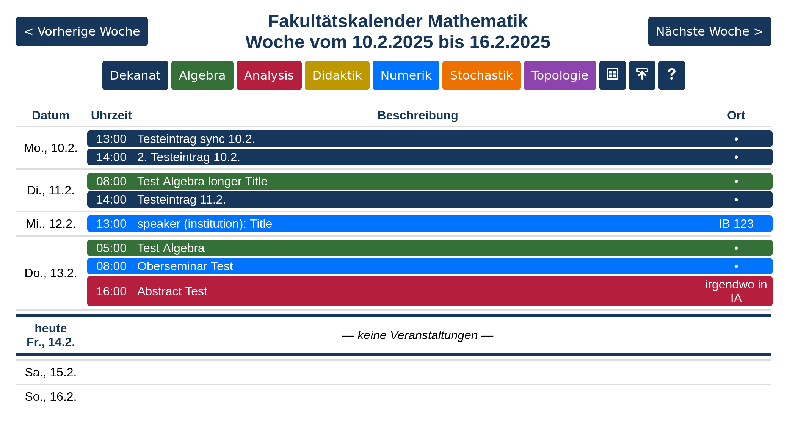
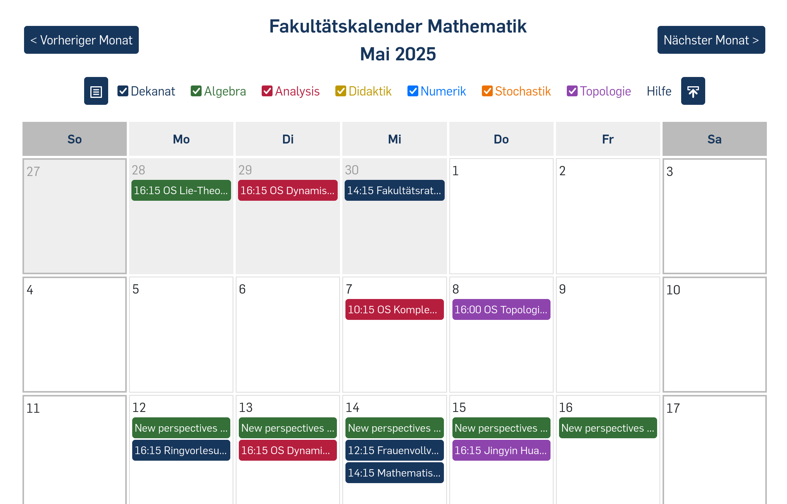
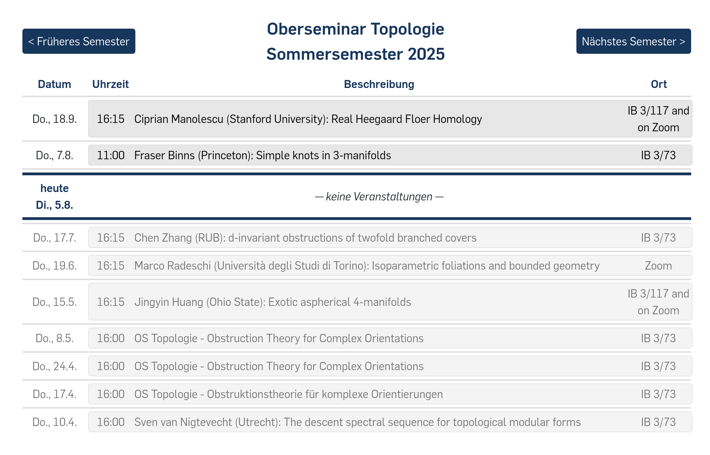

# Web-Calendar
- displays multiple ics-calendars in a browser
- written in html and javascript
- originally designed for the mathematics department at Ruhr University Bochum
- see live in use here: [week/month view](https://math.ruhr-uni-bochum.de/news/kalender/), [semester view](https://math.ruhr-uni-bochum.de/fakultaet/arbeitsbereiche/topologie/oberseminar-topologie/)
## Screenshot of the calendar | weekview

## Screenshot of the calendar | monthview

## Screenshot of the calendar | semesterview

## Acknowledgement of third party software used in this project
- _ical.js_ by (among others) [Philipp Kewisch (Mozilla)](https://github.com/kewisch/ical.js)
- _linkify.js_ by [Nick Frasser](https://linkify.js.org/)
- _MathJax_ by [Davide Cervone, Volker Sorge and other contributors](https://www.mathjax.org/), hosted on [jsdeliver](https://www.jsdelivr.com/)

